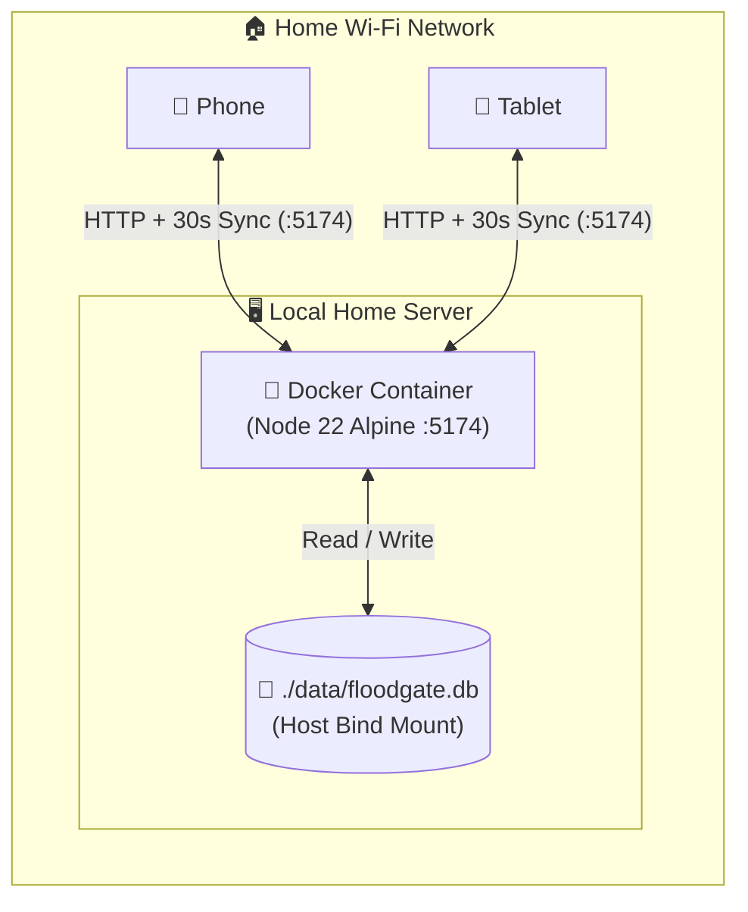

<div align="center">

# 🌊 Floodgate — Period & Endometriosis Tracker

**A self-hosted, private daily symptom journal for tracking period flow, blood clots, endometriosis pain, bowel/GI flare-ups, and medications across phone and tablet.**

[](https://react.dev/)
[](https://vitejs.dev/)
[](https://tailwindcss.com/)
[](https://nodejs.org/api/sqlite.html)
[](https://www.docker.com/)

</div>

---

## 📖 Overview

**Floodgate** is a 100% self-hosted web application designed to log and analyze daily period and endometriosis symptoms. It runs inside a single lightweight Docker container on a local home server—storing all data privately in an embedded **SQLite** database (`./data/floodgate.db`) with zero external cloud services—while keeping your phone and tablet automatically synchronized over home Wi-Fi.

### ✨ Key Features

* 👤 **Personalised Profile:** Enter your name on first launch (or anytime from the header badge or Sync & Backup settings) to personalise your journal, exported backups, and printable clinical summaries across all synced devices.
* 🩸 **Period & Bleeding Severity:** Log 6 clinical flow levels (`None`, `Spotting`, `Light`, `Medium`, `Heavy`, `Flooding`), track daily sanitary protection counts (pads, tampons, cups/period underwear), and flag flooding/leak-through episodes.
* 🟣 **Blood Clots Tracker:** Record whether blood clots were passed, approximate daily clot count, and observed clot sizes (`Small <1cm`, `Medium 1–2cm`, `Large >2cm`, and `Decidual / Tissue-like`).
* ⚡ **Endometriosis Pain & Cramping:** Interactive 0–10 pain score slider and button grid, 9 anatomical pain locations (including pelvic, lower back, ovarian, sciatic, and rectal shooting pain), and 6 pain character descriptors.
* 🧡 **Bowel & GI Symptoms:** Track overall bowel distress severity (`None` to `Severe`), 8 endometriosis-related GI symptoms (including *"Endo Belly"* bloating, painful bowel movements, constipation, diarrhea, and nausea), and daily bowel movement count.
* 💊 **Medication & External Factors:** One-tap preset medications (Ibuprofen, Mefenamic Acid, Tranexamic Acid, Co-codamol, Buscopan, Dienogest, etc.), custom medication entries, *"Copy Yesterday's Meds"*, per-medication relief effectiveness (`Helped`, `Partial`, `No Relief`), and 12 non-drug relief & trigger tags (Heat Pad, TENS Machine, Poor Sleep, Trigger Foods, Ovulation, etc.).
* 📅 **Interactive Monthly Calendar:** Colour-coded monthly overview with a side-by-side day inspector for reviewing any date at a glance.
* 🩺 **Insights & Printable GP / Gynecologist Report:** Rolling 30 / 60 / 90 / 365-day clinical KPI cards, pain-vs-bleeding correlation timeline chart, symptom frequency breakdowns, chronological consultation table, and print-ready formatting.
* 🔄 **Relaxed Phone & Tablet Local Sync:** Polls the local SQLite server every 30 seconds (and immediately on device wake/tab focus), plus auto-saves unsaved edits when switching dates or tabs.
* 🌙 **Low-Glare Flare Comfort Mode:** Warm daylight palette and low-glare dark mode persisted per device.

---

## 🏗️ Architecture

The application is compiled via a multi-stage Docker build and served by a zero-dependency **Node.js 22 Alpine** server (`server.js`) mapped to host port `5174`. Both the static React frontend and the REST API (`/api/state`, `/api/settings`, `/api/logs/:dateKey`, `/api/logs/batch`) run inside the same container, backed by Node 22's built-in `node:sqlite` engine writing to a bind-mounted `./data/floodgate.db` file on the host.



---

## 🚀 Getting Started (Docker Deployment)

### 1. Start with Docker Compose (Recommended)
Docker Compose builds the image, maps port `5174` on your host to port `80` in the container, and bind-mounts `./data` to `/app/data`:

```bash
docker compose up -d --build
```

### 2. Build & Run with `docker run`
If you prefer standalone Docker commands:

```powershell
# Build the multi-stage image
docker build -t floodgate .

# Run in detached mode on port 5174 with persistent folder mount
docker run -d --name floodgate-app -p 5174:80 -v "${PWD}/data:/app/data" --restart unless-stopped floodgate
```

### 3. Portable Server Deployment (Optional)
To build the image on your workstation and transfer it to your home server:

```powershell
# 1. Export the built image on your workstation
docker save -o floodgate.tar floodgate

# 2. Copy floodgate.tar to your server and load it
docker load -i floodgate.tar

# 3. Start the container on the server with a persistent data folder
docker run -d --name floodgate-app -p 5174:80 -v "C:\floodgate-data:/app/data" --restart unless-stopped floodgate
```

### 4. Windows Server Firewall Rule
If hosting on Windows, allow inbound LAN traffic on port `5174` via an Administrator Command Prompt:

```cmd
netsh advfirewall firewall add rule name="Allow Floodgate 5174" dir=in action=allow protocol=TCP localport=5174 profile=any
```

---

## 📱 Adding to Your Phone & Tablet

Once the container is running, open `http://<SERVER-LAN-IP>:5174` on your phone and tablet while connected to home Wi-Fi:

* **iOS / iPadOS (Safari):** Tap the **Share** button $\rightarrow$ **Add to Home Screen**.
* **Android (Chrome):** Tap the **Three-Dot Menu** $\rightarrow$ **Add to Home screen**.

---

## 🛠️ Local Development (Without Docker)

```bash
# Install dependencies
npm install

# Terminal 1: Start the local SQLite backend on port 3001
PORT=3001 npm start

# Terminal 2: Start Vite dev server (proxies /api to localhost:3001)
npm run dev
```

---

## 📂 Project Structure

```text
floodgate/
├── public/
│   └── favicon.svg         # Floodgate rose heart icon
├── src/
│   ├── App.jsx             # Floodgate UI, analytics & 30s local SQLite sync
│   ├── index.css           # Tailwind v4 imports, dark variant & print styles
│   └── main.jsx            # React entry point
├── data/                   # Persistent host folder containing floodgate.db (auto-created)
├── server.js               # Node 22 HTTP + built-in SQLite static & REST API server
├── index.html              # App shell & theme initialization script
├── vite.config.js          # Vite, Tailwind v4 plugin & /api dev proxy config
├── Dockerfile              # Multi-stage Node 22 build + runtime image
├── docker-compose.yml      # Single-command container + ./data volume setup (:5174)
├── .dockerignore           # Excludes host node_modules, dist, and local DB files
└── .gitignore              # Excludes build artifacts, .tar archives, and data/
```
